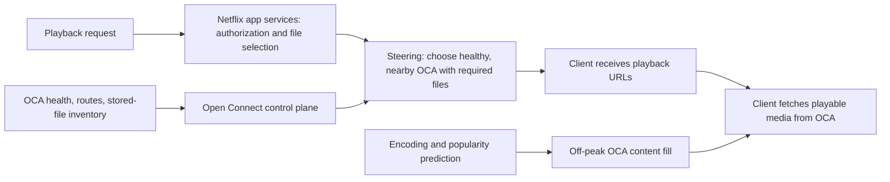

# Netflix streaming and low-cost scale research

**Research date:** 2026-10-30  
**Scope:** Public Netflix system design, playback and delivery, cost levers, the Colibrì/GLM disk-streaming analogy, and implications for Consumit. Sources are first-party Netflix materials, standards documents, the model publisher, and the Colibrì project itself. Netflix does not publish its full player implementation or all production internals, so the design below distinguishes public facts from inference.

## Findings

Netflix scales playback by separating playback authorization and file selection from media delivery. The playback service supplies a compatible manifest and license path; Open Connect's control plane uses OCA health, routes, stored-file inventory, and network proximity to steer the client to an eligible appliance. That OCA then serves encoded media over HTTP(S) and does not store member viewing or DRM data. Netflix describes these roles in its [Open Connect overview](https://openconnect.netflix.com/Open-Connect-Overview.pdf) and its [streaming fraud/abuse article](https://netflixtechblog.com/machine-learning-for-fraud-detection-in-streaming-services-b0b4ef3be3f6).

The catalog is prepared for many device and network combinations. Netflix describes separate codec/device profiles, bitrate levels, and audio and subtitle variants. The client chooses among compatible qualities as network conditions change; the selected bitrate affects picture quality and how quickly the local playback buffer drains. A manifest lists available streams, while a DRM license authorizes decryption on the device. Netflix's [streaming experience overview](https://netflixtechblog.com/a-b-testing-and-beyond-improving-the-netflix-streaming-experience-with-experimentation-and-data-5b0ae9295bdf) and [manifest/license explanation](https://netflixtechblog.com/machine-learning-for-fraud-detection-in-streaming-services-b0b4ef3be3f6) describe these roles but not the exact current player algorithm, manifest format, segment duration, or internal API contracts. For Consumit's HLS sources, the public [HTTP Live Streaming specification](https://datatracker.ietf.org/doc/html/rfc8216) describes master/media playlists and segments; it does not define Netflix's proprietary implementation.

## How Netflix reduces delivery cost

| Lever | Public evidence | What it means |
| --- | --- | --- |
| Localize bytes | OCAs sit inside participating ISP networks or at IXPs; Netflix says localization reduces network distance and upstream transit needs ([Open Connect](https://openconnect.netflix.com/)). | Fewer long-haul bytes and network hops can improve both cost and playback reliability. |
| Pre-position content | OCA files are refreshed off-peak; Netflix predicts demand from smoothed historical viewing to choose content/file placement ([Content Popularity for Open Connect](https://netflixtechblog.com/content-popularity-for-open-connect-b86d56f613b)). | Popular files can be nearby before the evening peak, avoiding repeated origin/backbone fetches. |
| Avoid storing every variant everywhere | Netflix reported that switching most clusters from title-level to file-level ranking achieved the same cache efficiency with 50% of storage in its 2017 system ([Content Popularity for Open Connect](https://netflixtechblog.com/content-popularity-for-open-connect-b86d56f613b)). | Cache placement granularity is a large storage/capacity lever; popularity and region matter. This is a historical Netflix result, not a guaranteed result for Consumit. |
| Compress better | Netflix's 2025 AV1 report says AV1 sessions in its November 2025 snapshot used one-third less bandwidth than AVC/HEVC, with higher average VMAF and fewer buffering interruptions ([AV1 report](https://netflixtechblog.com/av1-now-powering-30-of-netflix-streaming-02f592242d80)). | Smaller encodes save storage and delivery bandwidth, but require re-encoding, supported decoders, and careful device rollout. |
| Fit capacity to demand | Netflix reports OCA health/load feedback informs routing; partners can schedule content refresh off-peak ([Open Connect overview](https://openconnect.netflix.com/Open-Connect-Overview.pdf)). | Routing and fill decisions should use observed load and popularity rather than indiscriminately warming everything. |

Open Connect is not a cheap starter-CDN recipe. Netflix describes a large, long-running infrastructure investment and an ISP partnership model. The current Open Connect site says qualifying ISPs can receive appliances; partners supply power, space, and connectivity. That bargain only makes sense when a service has enough regional traffic and ISP leverage. A small product should use a managed CDN selectively and compare its bills with direct delivery before considering owned edge hardware. Sources: [Open Connect program](https://openconnect.netflix.com/), [2021 briefing paper](https://openconnect.netflix.com/Open-Connect-Briefing-Paper.pdf), and [appliance overview](https://openconnect.netflix.com/en/appliances/).

## The reel's model-streaming comparison

The project named in the reel is **Colibrì** (repository: [JustVugg/colibri](https://github.com/JustVugg/colibri)), not “Calibri.” The model publisher describes GLM-5.2 as 744B-A40B; Colibrì's current README says it keeps the dense model portion and an expert cache in RAM and fetches routed Mixture-of-Experts (MoE) weights from disk. Its benchmark page reports one particular 25 GB RAM development machine with roughly 9.9 GB of dense weights resident, roughly 20 GB peak process RSS, a roughly 370 GB int4 model, and about 0.05–0.1 tokens/second for cold disk-bound decoding. Those are upstream project measurements, not an independent benchmark or a typical laptop guarantee. Colibrì's own [README](https://github.com/JustVugg/colibri) and [benchmark notes](https://github.com/JustVugg/colibri/blob/main/docs/benchmarks.md) state that the storage device largely sets speed when experts are disk-backed.

The Netflix analogy is useful only at the broad idea of keeping a large corpus on slower storage and a working set in faster memory. The workloads are different:

- A video player requests encoded media for a time interval, buffers it, and decodes it sequentially. A CDN cache hit can serve those already-produced bytes without recomputing the movie.
- Colibrì's MoE runtime must fetch the experts selected by the model router as generation proceeds, then compute each next token. A cold step can incur substantial random reads and CPU work; the project's own benchmark reports around 11 GB of reads per token for its stated configuration.
- The local model still needs hundreds of gigabytes of disk in that configuration, substantial RAM for resident weights/cache/context, and may be very slow. “No GPU” describes a supported execution mode, not cloud-like throughput or efficient multi-member serving.

The transferable lesson for Consumit is “serve the next bounded piece from the closest valid cache, and keep the hot control state in fast storage.” It is not “a laptop disk can replace a video CDN.”

## Consumit implications

Consumit already has the right foundational split for its present product: the API resolves and validates configured Providers, the browser's Consumit Player owns media playback, and member progress stays keyed to the Title/Episode rather than a source URL. The current architecture says the product API does not relay video bytes; an explicitly configured Cloudflare Media Relay is an independent delivery path. See [ARCHITECTURE.md](../ARCHITECTURE.md), [ADR 0005](../adr/0005-direct-first-worker-relay.md), and [ADR 0009](../adr/0009-cloudflare-provider-resolution.md). The product also explicitly distinguishes fixed rendition choices from adaptive “Auto” quality in [PRODUCT.md](../PRODUCT.md).

### REA observation of the current production Watch route

REA ran a controlled Chromium scenario against the public `/watch/movie/550` route on 2026-10-30, with empty browser storage and no account credentials. The rendered page exposed the first-party Consumit Player (`data-player-core="legacy"`) and a native video element attached to a browser `blob:` URL. During the 30-second capture, the browser received HTTP 200 responses for three HLS playlists, three video segments, and three separate-audio segments from the configured media delivery origin. Playback API, subtitle, and skip-time requests went to Consumit's own origin. This is direct evidence that the observed session's media bytes bypassed the product API and that the source supplied separate audio; it is not evidence that every Provider follows this route.

The page still showed “Tap play to start watching,” and the scenario did not click Play. The capture therefore establishes playlist and segment fetches, not a decoded first frame, seek, resume, full-duration stability, or successful member playback. The scenario also ended with some requests unfinished. Evidence ID: `ev_97b2ea76f892c2384ef86efab8cd3d28535c854d6164a2be1a59f7cc89406bd0` (controlled replay; observed; Chromium 156; capture window about 30 seconds). Signed/session query values and provider URLs are intentionally omitted.

For capacity planning, separate peak concurrent viewers from monthly active members. At a sustained bitrate of `b` Mbps, one viewer-hour transfers about `0.45 × b` decimal GB. So 1,000 simultaneous 4 Mbps streams imply about 4 Gbps and 1.8 TB/hour from media delivery. With the current 25-second signed-in progress cadence, 1,000 active sessions average about 40 progress writes/second (bursts can be higher). These are arithmetic examples, not measured production demand or capacity. Direct delivery keeps those video bytes off Consumit's API/VPS, but they still consume the configured Provider's delivery capacity and terms; Relay carries its own Worker/VPS request, CPU, byte and quota costs. See the [browser-direct cost model](../COST-MODEL.md) and [ADR 0012](../adr/0012-provider-routing-and-scale.md).

### Recommended improvements, in order

1. **Keep media bytes off the product API.** Preserve browser-direct playback when the configured source and browser allow it. Use Relay only for providers with an explicitly approved, measured relay route. Keep relay cost and capacity limits visible: successful playback minutes, media bytes, Worker requests, CPU failures, and cost per successful watch hour. A resolution success is not a successful stream.
2. **Preserve and verify source-aware Auto quality.** Consumit already defaults to adaptive quality and keeps fixed rendition switching distinct. Use Auto only where the validated HLS/DASH source provides a usable adaptive ladder; keep fixed choices for fixed playlists. The REA capture saw a requested 720p playlist but did not read manifest bodies or test a quality switch, so it does not establish adaptive behavior for that route.
3. **Measure resolver coalescing before adding cache infrastructure.** Same-key in-flight resolution already coalesces and resolution is bounded. Measure duplicate suppression, cache hits, provider fan-out and p95/p99 latency under bursty demand. Add shared cache or background warming only when those measurements show a bottleneck, and keep short-lived discovery results separate from signed/expiring playback access.
4. **Measure the member experience and infrastructure separately.** Track startup-to-first-frame, rebuffer/stall time, seeks that fail to advance, quality switches, provider-resolution latency, recovery success, direct-versus-relay share, and relay bytes/requests/CPU. Use aggregate, low-cardinality telemetry that cannot expose a member's private viewing history. Use the measurements to decide whether an optimization improves successful playback per dollar.
5. **Scale the app in the order already planned.** Keep the monolith/modular boundaries and scale the web/API horizontally only when load measurements justify it. Defer a multi-region platform, a custom CDN, and owned cache appliances until traffic, bottlenecks, and unit economics demonstrate need. Netflix's edge investment is a response to huge predictable byte volume and ISP partnerships; it is not a first move for Consumit.

### Boundaries and unknowns

Netflix's public material supports the high-level content-delivery and player behavior above, not a complete reconstruction of its proprietary web/TV player. Exact rendition ladder policy, segment length, adaptive algorithm, live control-plane design, regional failure modes, and current per-view cost remain unknown from these sources. Consumit's cheapest route also varies by Provider, country, traffic volume, route success, and Cloudflare plan; benchmark the current production configuration instead of assuming a universal “free” route. No change to provider rights, source trust, or external content assumptions follows from this research.

## Sources

- Netflix, [Open Connect Overview](https://openconnect.netflix.com/Open-Connect-Overview.pdf), first-party architecture overview.
- Netflix, [Open Connect Briefing Paper: A cooperative approach to content delivery](https://openconnect.netflix.com/Open-Connect-Briefing-Paper.pdf), 2021.
- Netflix, [Open Connect program](https://openconnect.netflix.com/) and [Open Connect Appliances](https://openconnect.netflix.com/en/appliances/), current partner and appliance information, accessed 2026-10-30.
- Netflix Technology Blog, [A/B Testing and Beyond: Improving the Netflix Streaming Experience with Experimentation and Data](https://netflixtechblog.com/a-b-testing-and-beyond-improving-the-netflix-streaming-experience-with-experimentation-and-data-5b0ae9295bdf).
- Netflix Technology Blog, [Content Popularity for Open Connect](https://netflixtechblog.com/content-popularity-for-open-connect-b86d56f613b).
- Netflix Technology Blog, [Machine Learning for Fraud Detection in Streaming Services](https://netflixtechblog.com/machine-learning-for-fraud-detection-in-streaming-services-b0b4ef3be3f6), manifest/license overview.
- Netflix Technology Blog, [AV1 — Now Powering 30% of Netflix Streaming](https://netflixtechblog.com/av1-now-powering-30-of-netflix-streaming-02f592242d80), published 2025-12-01; performance figures are a stated snapshot from 2025-11-13.
- IETF RFC Editor, [RFC 8216: HTTP Live Streaming](https://datatracker.ietf.org/doc/html/rfc8216).
- Z.ai, [GLM-5 model repository](https://github.com/zai-org/GLM-5), model family and parameter-count source.
- JustVugg, [Colibrì source repository](https://github.com/JustVugg/colibri) and [benchmarks](https://github.com/JustVugg/colibri/blob/main/docs/benchmarks.md), implementation description and self-reported measurements.
