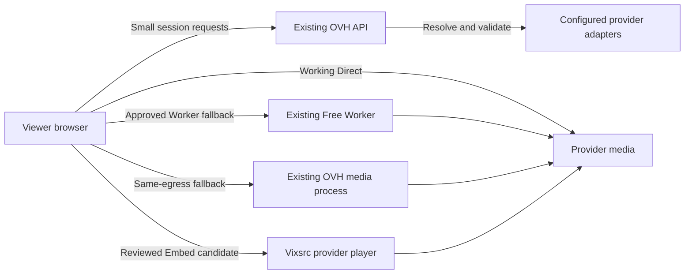

# Provider reliability without another subscription

Research date: 2026-10-11. The operator wants production playback to behave like local playback while keeping working Direct sources, using relay as fallback, and adding no hosting bill. This report combines primary-source research with actual browser checks. It proposes the next slices; it does not install another server, change OVH networking, enable a new provider, or weaken production iframe policy.

## Recommendation

Use the OVH VPS already purchased for bounded media fallback where the complete upstream graph works from OVH. Keep working browser Direct routes and independently tested Worker routes. For Vixsrc, a browser-owned provider Embed is now a measured no-server-media option; preserving Consumit-owned controls still needs an accepted lookup location plus independently playable links. A generic scraper, different DNS or another free VPS does not establish those capabilities.

The requirement can be met as **no additional infrastructure subscription within existing/free allowances**. It cannot honestly be promised as every provider always delivering Direct, every viewer region working, or unlimited viewing capacity.

## New account evidence: OVH already includes media traffic

The operator supplied screenshots showing model **VPS-3 2027**, six vCores and network region **ca-east-bhs**. OVH's current Canada product page lists that model with 12 GB RAM, 100 GB storage, unlimited traffic and **2 Gbps public bandwidth**. The Asia-Pacific quota exception on that page does not apply to the screenshot's Canadian region. This is a much more specific basis than the earlier generic unmetered-VPS research. [OVH Canada plan](https://www.ovhcloud.com/en-ca/vps/vps-canada/), [model configurator](https://www.ovhcloud.com/en-ca/vps/configurator/?brick=VPS%2BModel%2B3&planCode=vps-2027-model3&pricing=upfront12&processor=+&storage=100__SSD__NVMe&vcore=6__vCore).

Interpretation: an additional OVH media subscription is not needed to reuse the included public transfer allowance. This does not prove sustained 2 Gbps on the actual machine, spare application capacity, or an arbitrary workload's compliance with the account agreement. It is not a viewer-capacity certification. Avoid additional IPs, backup upgrades, paid proxies, object storage or CDN purchases in this slice.

The deployed media guard remains deliberately conservative: 12 Mbps aggregate response-body pacing, 16 active HTTP requests and 8 GB/day persistent quota. These are application safety controls, not OVH's purchased billing allowance. At an illustrative 4 Mbps, 8 GB corresponds to roughly 4.4 viewer-hours before overhead. Do not remove safeguards merely because transfer is unmetered; increase them only after full-title/concurrency measurements protect API/database headroom. The current two-viewer 160-second canary is useful proof, not sufficient evidence for a large expansion. [Deployed audit](./ovh-media-relay-2026-10-11.md), [media runbook](../runbooks/ovh-media-relay.md).

## Actual browser experiments in this research

### Viewer-side lookup fails the initial CORS gate

Chrome on the real production-origin About page requested Vixsrc's fixed movie-550 API and LookMovie's Fight Club catalog. Two legitimate referrer policies were tested independently: no-referrer and origin. Credentials were omitted, only safelisted Accept was supplied, CSP/CORS stayed active, provider documents were not executed and response reads were bounded. Both providers fail readable Fetch in both cases, with Chrome CORS-policy diagnostics. The no-cors controls return opaque responses, status zero and zero readable bytes. Remaining recipe hops cannot be reached through this route.

Sanitized artifacts: `local/production-playback/browser-lookup-cors-report.json` and `browser-lookup-origin-cors-report.json`. This is measured behavior for these endpoints and this origin/network/time. It rules out simply moving the present recipes into ordinary website JavaScript; it does not rule out future provider-approved browser interfaces. [Detailed browser research](./browser-egress-research-2026-10-11.md), [Fetch opaque responses](https://fetch.spec.whatwg.org/#concept-filtered-response-opaque).

### Vixsrc's published Embed plays without our media traffic

Vixsrc's first-party documentation offers movie/TV frame URLs, startAt, language and autoplay parameters, plus a PLAYER_EVENT protocol. Those are an integration interface for its own player, not an exported media URL for Consumit. [Vixsrc documentation](https://vixsrc.to/).

An initial no-referrer frame displays a specific rejection requiring an origin Referer. With an origin Referer, the standard Consumit sandbox did not decode the checked samples. In an isolated fresh browser context, the same published URLs with a plain iframe decoded movie 550 and series 1396 S1E1 at **1280×720**, started at 60 seconds and advanced beyond 64 seconds. The app origin was still https://consumit.online. No OVH resolver or Consumit media relay was involved. Test contexts closed afterward; no production frame policy changed.

Sanitized artifacts: `local/production-playback/vixsrc-embed-browser-report.json`, preserved `vixsrc-embed-no-referrer-report.json`, and the sandbox control report. HTTP 200 and frame loading alone are not counted as playback; decoded dimensions, advancing media time and observed provider video distinguish the positive result. Diagnostic automation observes the cross-origin frame through browser tooling; ordinary Consumit JavaScript still cannot read that DOM.

Limitations: the player and controls belong to Vixsrc. A plain iframe removes the standard sandbox's popup/top-navigation restrictions. No accepted PLAYER_EVENT messages were observed with the exact configured origin/source filter, so progress, completion, automatic next episode and cast are not certified. The published event contract needs its own measured provider-specific bridge before any progress writes. A generic frame adapter's server liveness check would reproduce OVH's 403, so a browser-owned candidate needs a reviewed canonical adapter path and honest browser failure handling. [Existing Embed decision](../adr/0006-provider-embed-fallback.md).

## Delivery architecture

Keep route selection behind the provider seam. Each Direct, Worker, OVH relay and Embed row is independently configured, validated and measured. Never reuse a source issued on one egress through a different media node when the paired tests show that fails. Preserve the same title/episode/session and member-owned checkpoints during native source changes. An Embed without verified events must retain its distinct progress limitations.

| Provider group | Best current no-new-subscription path | What is proven / still missing |
| --- | --- | --- |
| Working Direct samples, including Purstream and the previously checked Evion/CookieBakers/anime rows | Keep browser Direct | Deployed sample checks exist; no all-title guarantee |
| LookMovie | Existing same-OVH relay fallback | Deployed Watch decodes, seeks, switches quality, renders captions/uploads and renews a capability; longer soaks remain |
| OVH-resolving but viewer-invalid candidates such as AnimeKai | Test the complete graph through the existing media process before a separately scoped route | OVH-versus-viewer mismatch evidence exists; no new route certified here |
| Header-sensitive candidates | Provider-owned hints through a reviewed relay, if every required asset is accessible | Adapter-specific graph/host behavior must be proven; headers alone cannot fix blocked bytes |
| Vixsrc with provider controls accepted | Browser-owned provider Embed | Movie/episode decode measured in a plain diagnostic iframe; product/security integration and events remain open |
| Vixsrc with Consumit-owned controls required | Optional accepted lookup node, then cross-viewer Direct test | No accepted always-on cloud node has been proven; no zero-cost guarantee |
| Existing approved Worker providers | Retain tested Free Worker route and caps | Existing compatibility differs by provider; Free CPU/request limits remain |

## Why a VPS control-panel setting is not the missing architecture

Reverse DNS changes the hostname associated with an address, not the source address or network identity of the HTTP connection. OVH documents it as reverse/PTR lookup. Changing that name does not make OVH requests originate from the viewer. [OVH reverse-DNS guide](https://docs.ovhcloud.com/en/guides/bare-metal-cloud/virtual-private-servers/configuring-reverse-dns).

Vixsrc's tested OVH IPv4 and IPv6 requests receive upstream HTTP 403 challenges. That is an upstream response, not proof that a local firewall prevented connectivity. The precise upstream rejection rule remains unknown; do not turn the evidence into a claim that every address in OVH's ASN is permanently blocked. DNS, timezone, disabled firewall or more CPU has no demonstrated fix for this rejection. Browser-like resolver execution on OVH is also unproven; no CAPTCHA-solving, challenge-evasion or permanent browser service was added in this research.

For LookMovie, the exact same fresh link works from the issuing connection and returns eleven non-media bytes from the other connection, regardless of production Origin. A server redirect still leaves the final media request on the viewer's connection. Native playback cannot turn those denied bytes into media. The same-egress relay is the measured repair. [Paired evidence](./provider-production-parity-2026-10-10.md).

Cloudflare website proxy status affects requests to the website hostname; it does not route the viewer's separate Direct provider requests through OVH. Keep the website/API Tunnel and the DNS-only media hostname as already deployed. [Cloudflare proxy behavior](https://developers.cloudflare.com/dns/proxy-status/).

## Free Worker and free VPS assessment

Workers Free has finite daily request and CPU budgets: 100,000 requests/account/day and 10 ms CPU/invocation. At an illustrative six-second multiplexed HLS segment cadence, one viewer-hour generates 600 segment requests before manifests, audio, subtitles, keys, retries and other Workers. Seven continuously active viewers exceed the video-only daily budget. No per-GB Workers charge is listed, but that is not proof of unlimited accepted traffic or provider compatibility. Public Free Tunnel and ordinary CDN video constraints are separate from Workers' Developer Platform terms; do not incorrectly describe all Worker video as banned. [Workers limits](https://developers.cloudflare.com/workers/platform/limits/), [pricing](https://developers.cloudflare.com/workers/platform/pricing/), [detailed service research](./worker-media-research-2026-10-11.md).

Oracle Always Free remains the strongest optional lookup-node experiment: current A1 allocation equivalent to two OCPUs/12 GB, with 10 TB eligible outbound/month. Regional capacity, idle reclamation and lack of Free Tier SLA prevent treating it as a production guarantee. It has not been tested against Vixsrc. Google VM compute is free within allowances but ordinary external IPv4 is billed; AWS Free compute is time/credit bounded; sleeping hobby services are poor permanent media nodes. [Oracle resources](https://docs.oracle.com/en-us/iaas/Content/FreeTier/freetier_topic-Always_Free_Resources.htm), [hosting comparison](./free-egress-research-2026-10-11.md).

An optional extension or existing home node can execute lookup on the viewer/owner network, but introduces installation, browser coverage, uptime and security/maintenance requirements. It is not a transparent website fix or a zero-resource-cost guarantee. No extension or home agent is installed. [Chrome extension network permissions](https://developer.chrome.com/docs/extensions/develop/concepts/network-requests).

## Smallest coherent follow-up

1. Keep the proven LookMovie route and working Direct providers. Use full-title and increasing-concurrency checks before adjusting the existing OVH media guard. The unmetered transfer evidence removes the reason to buy another server just for LookMovie traffic.
2. Test one additional OVH-compatible candidate's complete graph, headers, captions, seek and renewal. Only then add its explicit reviewed recipe/route, keeping independent key/origin and finite public-host scope.
3. If provider controls are acceptable, prepare a concrete Vixsrc Embed slice with canonical movie/episode URLs, origin referrer, explicit frame-policy tradeoff and honest recovery. Do not claim native-player parity or progress support before the event gate passes.
4. If Consumit controls are mandatory for Vixsrc, test an owner-provisioned Oracle Always Free node without paid upgrades. Require paired exact-link playback from independent viewer connections before admitting Direct; if links are bound, the same accepted node must carry their media within its free allowance.

This research yields a practical no-new-subscription architecture and a measured Vixsrc alternative. It does not yield a setting or universal free proxy that makes every external provider browser Direct.
